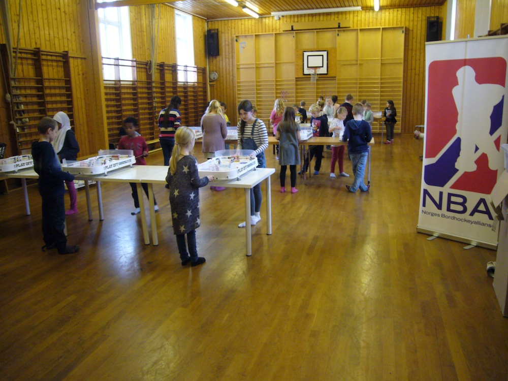
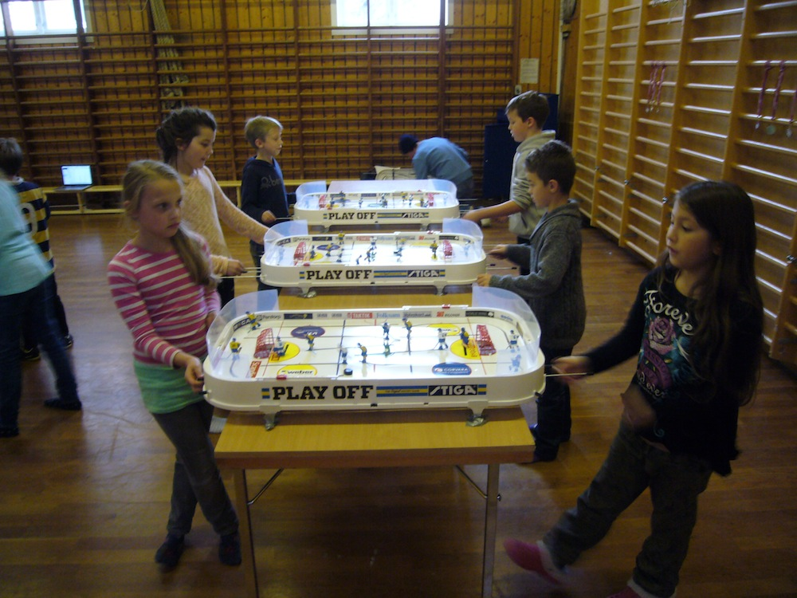

### Skulemeisterskap Krohnengen haust 2014, 07.11.2014

**Tabell Agurk**

|     |                                       |     |     |     |     |     |     |     |     |
|-----|---------------------------------------|-----|-----|-----|-----|-----|-----|-----|-----|
| Pl  | Navn                                  | K   | S   | U   | T   | MS  | MI  | +/- | P   |
| 1\. | Christian Iversen, Krohnengen BHK     | 6   | 4   | 1   | 1   | 6   | 1   | 5   | 9   |
| 2\. | Laurynas Griciute, Krohnengen BHK     | 6   | 3   | 2   | 1   | 11  | 7   | 4   | 8   |
| 3\. | Julian K. Fjaren, Krohnengen BHK      | 6   | 3   | 2   | 1   | 4   | 4   | 0   | 8   |
| 4\. | Selma Standal Barstad, Krohnengen BHK | 6   | 2   | 2   | 2   | 4   | 4   | 0   | 6   |
| 5\. | Laurita Griciute, Krohnengen BHK      | 6   | 0   | 4   | 2   | 6   | 8   | -2  | 4   |
| 6\. | Marielle F. Olderkjar, Krohnengen BHK | 6   | 0   | 4   | 2   | 2   | 6   | -4  | 4   |
| 7\. | Nikolai Lokvik, Krohnengen BHK        | 6   | 0   | 3   | 3   | 1   | 4   | -3  | 3   |

**Resultater Agurk**

Christian Iversen - Marielle F. Olderkjar 1-0

Christian Iversen - Laurita Griciute 0-0

Christian Iversen - Julian K. Fjaren 3-0

Christian Iversen - Nikolai Lokvik 1-0

Christian Iversen - Laurynas Griciute 0-1

Christian Iversen - Selma Standal Barstad 1-0

Julian K. Fjaren - Laurynas Griciute 0-0

Julian K. Fjaren - Selma Standal Barstad 2-1

Julian K. Fjaren - Christian Iversen 0-3

Julian K. Fjaren - Marielle F. Olderkjar 0-0

Julian K. Fjaren - Laurita Griciute 1-0

Julian K. Fjaren - Nikolai Lokvik 1-0

Selma Standal Barstad - Laurita Griciute 0-0

Selma Standal Barstad - Julian K. Fjaren 1-2

Selma Standal Barstad - Nikolai Lokvik 1-0

Selma Standal Barstad - Laurynas Griciute 2-1

Selma Standal Barstad - Christian Iversen 0-1

Selma Standal Barstad - Marielle F. Olderkjar 0-0

Laurita Griciute - Selma Standal Barstad 0-0

Laurita Griciute - Christian Iversen 0-0

Laurita Griciute - Marielle F. Olderkjar 2-2

Laurita Griciute - Julian K. Fjaren 0-1

Laurita Griciute - Nikolai Lokvik 0-0

Laurita Griciute - Laurynas Griciute 4-5

Laurynas Griciute - Julian K. Fjaren 0-0

Laurynas Griciute - Nikolai Lokvik 1-1

Laurynas Griciute - Selma Standal Barstad 1-2

Laurynas Griciute - Christian Iversen 1-0

Laurynas Griciute - Marielle F. Olderkjar 3-0

Laurynas Griciute - Laurita Griciute 5-4

Marielle F. Olderkjar - Christian Iversen 0-1

Marielle F. Olderkjar - Laurita Griciute 2-2

Marielle F. Olderkjar - Julian K. Fjaren 0-0

Marielle F. Olderkjar - Nikolai Lokvik 0-0

Marielle F. Olderkjar - Laurynas Griciute 0-3

Marielle F. Olderkjar - Selma Standal Barstad 0-0

Nikolai Lokvik - Laurynas Griciute 1-1

Nikolai Lokvik - Selma Standal Barstad 0-1

Nikolai Lokvik - Christian Iversen 0-1

Nikolai Lokvik - Marielle F. Olderkjar 0-0

Nikolai Lokvik - Laurita Griciute 0-0

Nikolai Lokvik - Julian K. Fjaren 0-1

------------------------------------------------------------------------

**Tabell Banan**

|     |                                            |     |     |     |     |     |     |     |     |
|-----|--------------------------------------------|-----|-----|-----|-----|-----|-----|-----|-----|
| Pl  | Navn                                       | K   | S   | U   | T   | MS  | MI  | +/- | P   |
| 1\. | Arild Seim, Krohnengen BHK                 | 5   | 2   | 2   | 1   | 2   | 1   | 1   | 6   |
| 2\. | Synne Tungen, Krohnengen BHK               | 5   | 1   | 4   | 0   | 2   | 1   | 1   | 6   |
| 3\. | Elias Kapsberger Mikkelsen, Krohnengen BHK | 5   | 2   | 2   | 1   | 4   | 3   | 1   | 6   |
| 4\. | Nora Johanne Kunce, Krohnengen BHK         | 5   | 1   | 3   | 1   | 2   | 2   | 0   | 5   |
| 5\. | Ella Hauso Hafsaas, Krohnengen BHK         | 5   | 0   | 4   | 1   | 0   | 1   | -1  | 4   |
| 6\. | Elisa , Krohnengen BHK                     | 5   | 0   | 3   | 2   | 0   | 2   | -2  | 3   |

**Resultater Banan**

Elias Kapsberger Mikkelsen - Nora Johanne Kunce 1-1

Elias Kapsberger Mikkelsen - Arild Seim 0-1

Elias Kapsberger Mikkelsen - Elisa 1-0

Elias Kapsberger Mikkelsen - Synne Tungen 1-1

Elias Kapsberger Mikkelsen - Ella Hauso Hafsaas 1-0

Elisa - Ella Hauso Hafsaas 0-0

Elisa - Synne Tungen 0-0

Elisa - Elias Kapsberger Mikkelsen 0-1

Elisa - Nora Johanne Kunce 0-0

Elisa - Arild Seim 0-1

Synne Tungen - Arild Seim 0-0

Synne Tungen - Elisa 0-0

Synne Tungen - Ella Hauso Hafsaas 0-0

Synne Tungen - Elias Kapsberger Mikkelsen 1-1

Synne Tungen - Nora Johanne Kunce 1-0

Arild Seim - Synne Tungen 0-0

Arild Seim - Elias Kapsberger Mikkelsen 1-0

Arild Seim - Nora Johanne Kunce 0-1

Arild Seim - Ella Hauso Hafsaas 0-0

Arild Seim - Elisa 1-0

Ella Hauso Hafsaas - Elisa 0-0

Ella Hauso Hafsaas - Nora Johanne Kunce 0-0

Ella Hauso Hafsaas - Synne Tungen 0-0

Ella Hauso Hafsaas - Arild Seim 0-0

Ella Hauso Hafsaas - Elias Kapsberger Mikkelsen 0-1

Nora Johanne Kunce - Elias Kapsberger Mikkelsen 1-1

Nora Johanne Kunce - Ella Hauso Hafsaas 0-0

Nora Johanne Kunce - Arild Seim 1-0

Nora Johanne Kunce - Elisa 0-0

Nora Johanne Kunce - Synne Tungen 0-1

------------------------------------------------------------------------

**Tabell Eple**

|     |                                      |     |     |     |     |     |     |     |     |
|-----|--------------------------------------|-----|-----|-----|-----|-----|-----|-----|-----|
| Pl  | Navn                                 | K   | S   | U   | T   | MS  | MI  | +/- | P   |
| 1\. | Adiran Hellevik, Krohnengen BHK      | 5   | 3   | 2   | 0   | 4   | 1   | 3   | 8   |
| 2\. | August Kjarland, Krohnengen BHK      | 5   | 2   | 3   | 0   | 4   | 0   | 4   | 7   |
| 3\. | Synva Haugo, Krohnengen BHK          | 5   | 2   | 1   | 2   | 2   | 2   | 0   | 5   |
| 4\. | Pernille Vangen, Krohnengen BHK      | 5   | 0   | 4   | 1   | 0   | 3   | -3  | 4   |
| 5\. | Jone Strom Rodset, Krohnengen BHK    | 5   | 1   | 1   | 3   | 5   | 7   | -2  | 3   |
| 6\. | Mia Vonheim Mccarthy, Krohnengen BHK | 5   | 0   | 3   | 2   | 1   | 3   | -2  | 3   |

**Resultater Eple**

Mia Vonheim Mccarthy - Jone Strom Rodset 1-1

Mia Vonheim Mccarthy - Pernille Vangen 0-0

Mia Vonheim Mccarthy - August Kjarland 0-0

Mia Vonheim Mccarthy - Synva Haugo 0-1

Mia Vonheim Mccarthy - Adiran Hellevik 0-1

August Kjarland - Adiran Hellevik 0-0

August Kjarland - Synva Haugo 1-0

August Kjarland - Mia Vonheim Mccarthy 0-0

August Kjarland - Jone Strom Rodset 3-0

August Kjarland - Pernille Vangen 0-0

Synva Haugo - Pernille Vangen 0-0

Synva Haugo - August Kjarland 0-1

Synva Haugo - Adiran Hellevik 0-1

Synva Haugo - Mia Vonheim Mccarthy 1-0

Synva Haugo - Jone Strom Rodset 1-0

Pernille Vangen - Synva Haugo 0-0

Pernille Vangen - Mia Vonheim Mccarthy 0-0

Pernille Vangen - Jone Strom Rodset 0-3

Pernille Vangen - Adiran Hellevik 0-0

Pernille Vangen - August Kjarland 0-0

Adiran Hellevik - August Kjarland 0-0

Adiran Hellevik - Jone Strom Rodset 2-1

Adiran Hellevik - Synva Haugo 1-0

Adiran Hellevik - Pernille Vangen 0-0

Adiran Hellevik - Mia Vonheim Mccarthy 1-0

Jone Strom Rodset - Mia Vonheim Mccarthy 1-1

Jone Strom Rodset - Adiran Hellevik 1-2

Jone Strom Rodset - Pernille Vangen 3-0

Jone Strom Rodset - August Kjarland 0-3

Jone Strom Rodset - Synva Haugo 0-1

------------------------------------------------------------------------

**Tabell Pære**

|     |                                      |     |     |     |     |     |     |     |     |
|-----|--------------------------------------|-----|-----|-----|-----|-----|-----|-----|-----|
| Pl  | Navn                                 | K   | S   | U   | T   | MS  | MI  | +/- | P   |
| 1\. | Elias Lihaug Jordal, Krohnengen BHK  | 5   | 3   | 2   | 0   | 8   | 0   | 8   | 8   |
| 2\. | Eva Henjesand, Krohnengen BHK        | 5   | 3   | 2   | 0   | 8   | 1   | 7   | 8   |
| 3\. | Yeabsira Ostrem, Krohnengen BHK      | 5   | 3   | 1   | 1   | 6   | 3   | 3   | 7   |
| 4\. | Mona Faaney, Krohnengen BHK          | 5   | 1   | 2   | 2   | 2   | 3   | -1  | 4   |
| 5\. | Ingrid Emilie Wiseth, Krohnengen BHK | 5   | 0   | 2   | 3   | 0   | 8   | -8  | 2   |
| 6\. | Vilde Anvik Vindal, Krohnengen BHK   | 5   | 0   | 1   | 4   | 0   | 9   | -9  | 1   |

**Resultater Pære**

Mona Faaney - Eva Henjesand 0-1

Mona Faaney - Vilde Anvik Vindal 1-0

Mona Faaney - Ingrid Emilie Wiseth 0-0

Mona Faaney - Elias Lihaug Jordal 0-0

Mona Faaney - Yeabsira Ostrem 1-2

Ingrid Emilie Wiseth - Yeabsira Ostrem 0-2

Ingrid Emilie Wiseth - Elias Lihaug Jordal 0-5w

Ingrid Emilie Wiseth - Mona Faaney 0-0

Ingrid Emilie Wiseth - Eva Henjesand 0-1

Ingrid Emilie Wiseth - Vilde Anvik Vindal 0-0

Elias Lihaug Jordal - Vilde Anvik Vindal 2-0

Elias Lihaug Jordal - Ingrid Emilie Wiseth 5-0w

Elias Lihaug Jordal - Yeabsira Ostrem 1-0

Elias Lihaug Jordal - Mona Faaney 0-0

Elias Lihaug Jordal - Eva Henjesand 0-0

Vilde Anvik Vindal - Elias Lihaug Jordal 0-2

Vilde Anvik Vindal - Mona Faaney 0-1

Vilde Anvik Vindal - Eva Henjesand 0-5

Vilde Anvik Vindal - Yeabsira Ostrem 0-1

Vilde Anvik Vindal - Ingrid Emilie Wiseth 0-0

Yeabsira Ostrem - Ingrid Emilie Wiseth 2-0

Yeabsira Ostrem - Eva Henjesand 1-1

Yeabsira Ostrem - Elias Lihaug Jordal 0-1

Yeabsira Ostrem - Vilde Anvik Vindal 1-0

Yeabsira Ostrem - Mona Faaney 2-1

Eva Henjesand - Mona Faaney 1-0

Eva Henjesand - Yeabsira Ostrem 1-1

Eva Henjesand - Vilde Anvik Vindal 5-0

Eva Henjesand - Ingrid Emilie Wiseth 1-0

Eva Henjesand - Elias Lihaug Jordal 0-0

------------------------------------------------------------------------

**Sluttspill A**

**Kvartfinaler:**

Elias Lihaug Jordal - August Kjarland 0-1 (1-2ssp)

Christian Iversen - Synne Tungen 1-0 (2-1ssp)

Arild Seim - Laurynas Griciute 0-1 (0-2)

Adiran Hellevik - Eva Henjesand 0-1 (1-2ssp)

**Semifinaler:**

Christian Iversen - August Kjarland 1-0 (2-1ssp)

Eva Henjesand - Laurynas Griciute 1-0 (1-0)

**Finale:**

Christian Iversen - Eva Henjesand 1-0 (3-0)

**Bronsefinale:**

Laurynas Griciute - August Kjarland 0-1 (0-1)

------------------------------------------------------------------------

**Sluttspill B**

**Kvartfinaler:**

Julian K. Fjaren - Mona Faaney 1-0 (1-0)

Elias Kapsberger Mikkelsen - Pernille Vangen 1-0 (5-0)

Synva Haugo - Nora Johanne Kunce 0-1 (1-2ssp)

Yeabsira Ostrem - Selma Standal Barstad 1-0 (2-1)

**Semifinaler:**

Julian K. Fjaren - Nora Johanne Kunce 1-0 (2-0)

Elias Kapsberger Mikkelsen - Yeabsira Ostrem 0-1 (0-1)

**Finale:**

Julian K. Fjaren - Yeabsira Ostrem 1-0 (1-0)

**Bronsefinale:**

Elias Kapsberger Mikkelsen - Nora Johanne Kunce 1-0 (1-0)

------------------------------------------------------------------------

**Sluttspill C**

**Kvartfinaler:**

Nikolai Lokvik - W.O.

Marielle F. Olderkjar - W.O.

Ella Hauso Hafsaas - W.O.

Jone Strom Rodset - Elisa 1-0 (1-0ssp)

**Semifinaler:**

Nikolai Lokvik - Jone Strom Rodset 1-0 (1-0w)

Marielle F. Olderkjar - Ella Hauso Hafsaas 0-1 (0-1w)

**Finale:**

Nikolai Lokvik - Ella Hauso Hafsaas 1-0 (1-0ssp)

**Bronsefinale:**

Marielle F. Olderkjar - Jone Strom Rodset 0-1 (0-1ssp)

------------------------------------------------------------------------

Endelig rekkefølge:

1\. Christian Iversen

2\. Eva Henjesand

3\. August Kjarland

4\. Laurynas Griciute

5\. Adiran Hellevik

6\. Elias Lihaug Jordal

7\. Arild Seim

8\. Synne Tungen

9\. Julian K. Fjaren

10\. Yeabsira Ostrem

11\. Elias Kapsberger Mikkelsen

12\. Nora Johanne Kunce

13\. Synva Haugo

14\. Selma Standal Barstad

15\. Mona Faaney

16\. Pernille Vangen

17\. Nikolai Lokvik

18\. Ella Hauso Hafsaas

19\. Jone Strom Rodset

20\. Marielle Olderkjar

21\. Elisa

22\. Laurita Griciute

23\. Ingrid Emilie Wiseth

24\. Mia Vonheim Mccarthy

25\. Vilde Anvik Vindal

## Bilete frå Skulemeisterskap Krohnengen haust 2014, 07.11.2014

*Gruppe Pære*

*Gruppe Agurk*

*Gruppe Banan*

*Gruppe Eple*

*Gruppe Pære*
